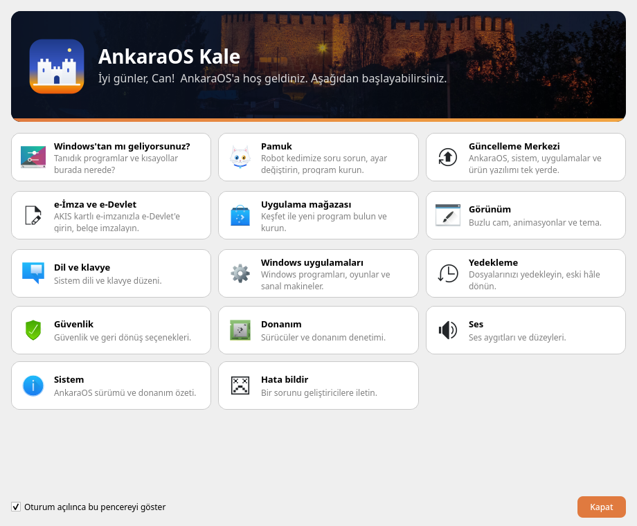
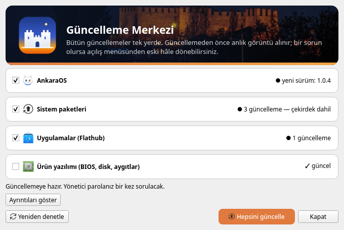
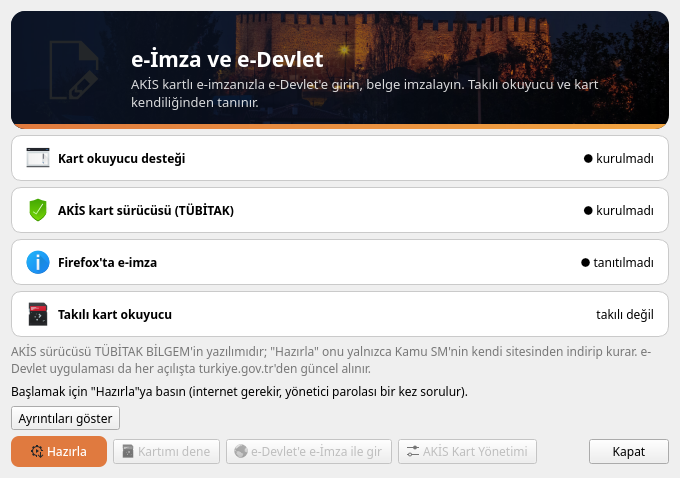
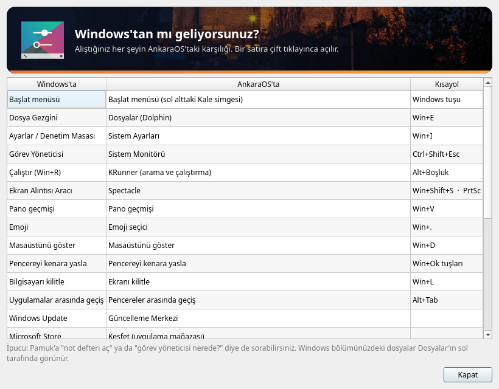
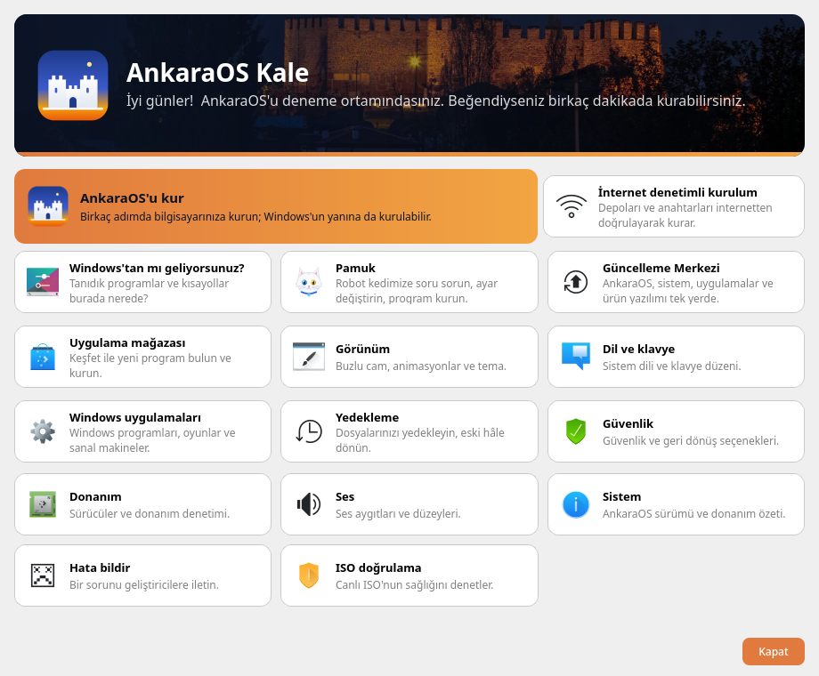

# AnkaraOS Kale

**Arch Linux tabanlı, KDE Plasma masaüstlü, Türkçe bir Linux dağıtımı.** Windows'tan geçenler yabancılık çekmesin
diye tasarlandı; Türkiye'ye özgü ihtiyaçları (e-İmza, e-Devlet) düşünür; içinde **Pamuk** adında, bilgisayarınızda
yerel çalışan bir yapay zeka yardımcısı (robot kedi) var.

🌐 **İndirme sayfası:** <https://canabanoz06.github.io/ankaraos/> · 🐞 **Sorun bildirin:** [Issues](../../issues)

*[English below](#english)*



## Öne çıkanlar

- **Kolay kurulum:** Türkçe grafik kurucu; diski silerek ya da **Windows'un yanına** (Windows bölümünü otomatik
  küçültür) kurulum, isteğe bağlı **disk şifreleme**, **Secure Boot** desteği.
- **Bozulursa geri dönün:** Btrfs anlık görüntüleri; her güncellemeden önce kendiliğinden yedek noktası alınır,
  açılış menüsünden eski hâle dönülür. Açılmayan güncellemeden sonra menü kendiliğinden gelir.
- **Güncelleme Merkezi:** AnkaraOS, sistem paketleri, Flathub uygulamaları ve ürün yazılımı tek pencerede;
  "Hepsini güncelle" ile parola bir kez sorulur. İsterseniz arka planda indirir, prizdeyken kendisi kurar.
- **Windows'tan gelenler için:** tanıdık kısayollar (Win+E, Win+D, Ctrl+Shift+Esc…), "Windows'tan mı
  geliyorsunuz?" rehberi, Word/Excel/PowerPoint biçiminde kaydeden LibreOffice, Office belgelerinin düzenini koruyan
  yazı tipleri, Windows programları için Wine/Bottles, masaüstünde Çöp Kutusu.
- **e-İmza ve e-Devlet:** AKİS kartlı e-imza tek düğmeyle hazırlanır (kart okuyucu desteği, TÜBİTAK sürücüsü Kamu
  SM'nin sitesinden, Firefox tanıtımı); e-Devlet'e e-İmza ile giriş aynı pencereden.
- **Pamuk (yapay zeka):** Türkçe soru-cevap, ayar değiştirme, program kurma, sorun bulma, dosya (PDF, Office,
  resimdeki yazı) okuma. **Tamamen yerel** çalışır (Gemma 4 E4B, llama.cpp); verileriniz bilgisayardan çıkmaz.
  Çevrimiçi kip isteğe bağlıdır ve varsayılan olarak kapalıdır.
- **Gizlilik:** "Hata bildir" raporunda bilgisayar adı, kullanıcı adı, ağ adresleri ve seri numaraları gizlenir;
  gönderilecek metni önce siz görürsünüz.

| | |
|---|---|
|  |  |
|  |  |

## Sistem gereksinimleri

| | En az | Önerilen |
|---|---|---|
| İşlemci | 64 bit (x86-64), UEFI | 4 çekirdek |
| Bellek | 4 GB | 8 GB ve üstü (Pamuk'un büyük modeli için) |
| Disk | 40 GB | 100 GB, SSD |
| USB bellek | 8 GB (hafif ISO) | 16 GB (tam ISO) |

Kurucu yalnızca **UEFI** ile açılan bilgisayarlarda çalışır (2012'den sonraki bilgisayarların neredeyse hepsi).

## İndirme ve kurulum

1. [İndirme sayfasından](https://canabanoz06.github.io/ankaraos/) ISO'yu indirin:
   - **Tam ISO (~11 GB):** Pamuk'un büyük modeli içinde, kurulumda indirme yok.
   - **Hafif ISO (~6 GB):** 8 GB'lık USB'ye sığar; model kurulumdan sonra indirilir.
2. İsterseniz dosyayı doğrulayın (aşağıya bakın).
3. ISO'yu USB belleğe yazın: Windows'ta [Rufus](https://rufus.ie) ya da [Ventoy](https://www.ventoy.net); Linux'ta
   `sudo dd if=ankaraos-….iso of=/dev/sdX bs=4M status=progress oflag=sync` (`sdX`: USB belleğiniz — doğru
   diski seçtiğinizden emin olun, içindekiler silinir).
4. Bilgisayarı USB'den açın (açılışta F12/F9/Esc ile önyükleme menüsü). Önce kurmadan deneyebilirsiniz; beğenirseniz
   masaüstündeki **"AnkaraOS'u kur"**.

**Windows'un yanına kurmadan önce:** Windows'ta *Hızlı Başlatma*'yı kapatın ve BitLocker açıksa askıya alın; önemli
dosyalarınızı yedekleyin. Secure Boot açıksa kurulumun sonunda bir **6 haneli kod** gösterilir: ilk açılışta mavi
ekranda (MokManager) "Enroll MOK" ile bu kodu girin.

### Doğrulama

Sürüm anahtarı parmak izi: `D5FE CBD6 330A 7272 030A  EC0A B361 BC62 E6D6 1226`

```bash
gpg --import ankaraos-release-key.asc
gpg --verify ankaraos-….iso.sig ankaraos-….iso
sha256sum -c SHA256SUMS --ignore-missing
```

## Güncellemeler

Kurulu sistem yeni sürümleri kendisi bildirir: **Başlat menüsü > Güncelleme Merkezi**. AnkaraOS'a özel dosyalar
imzalı güncelleme paketiyle, sistem paketleri Arch Linux depolarından gelir; ikisi de aynı pencerede.

**1.0.0-rc21 – rc24 kurduysanız** bir kez Konsole'da şunu çalıştırın (eski güncelleme adresi kapandı):

```bash
echo https://canabanoz06.github.io/ankaraos/ | sudo tee /etc/ankaraos/release-url
sudo ankaraos-release-check --install
```

## Sorun bildirme

AnkaraOS Merkezi'nde **"Hata bildir"**: kısa bir açıklama yazarsınız, sistem özeti (gizli bilgiler maskelenmiş)
hazırlanır, burada yeni bir kayıt sayfası açılır; göndermeyi siz yaparsınız. Elle de
[yeni bir kayıt](../../issues/new) açabilirsiniz.

## Lisans ve emeği geçenler

AnkaraOS'un kendi araçları **GPL-3.0-or-later** lisanslıdır; dağıtım, kendi lisanslarıyla gelen Arch Linux, KDE ve
diğer özgür yazılımları içerir. Bazı bileşenler (ör. kurulumda isteğe bağlı NVIDIA sürücüsü; kullanıcı istediğinde
Kamu SM'den indirilen AKİS sürücüsü) özgür değildir ve kendi lisanslarına tabidir. Yazılım **garantisiz** sunulur.

- Pamuk modeli: Gemma 4 E4B (Google, Apache 2.0) — ggml-org GGUF dönüşümü.
- Duvar kâğıdı "Eymir Gölü": mustafa ozdemir, CC BY-SA 2.0 (Wikimedia Commons).
- Açılış ekranı ve yukarıdaki ekran görüntülerinin başlığındaki "Ankara Kalesi, gece" fotoğrafı: Diego Delso,
  CC BY-SA 4.0 (Wikimedia Commons); kırpılıp karartıldı. Ekran görüntüleri de aynı lisansla paylaşılır.
- Slayt gösterisindeki Ankara fotoğrafları ve tam liste: sistemde `/usr/share/doc/ankaraos/CREDITS.md`.

AnkaraOS bağımsız bir projedir; Arch Linux, KDE, TÜBİTAK, Kamu SM ya da Türksat ile resmî bir bağı yoktur.

---

## English

**AnkaraOS Kale** is a Turkish Linux distribution based on **Arch Linux** with the **KDE Plasma** desktop. It is designed
so that people coming from Windows feel at home, supports Turkey-specific needs such as **e-signature (AKIS cards) and
e-Devlet login**, and ships **Pamuk**, an AI assistant that runs **entirely locally** (Gemma 4 E4B via llama.cpp).

- Graphical installer (erase disk or install **next to Windows**), optional disk encryption, **Secure Boot**
- Btrfs snapshots before every update and rollback from the boot menu
- **Update Center**: AnkaraOS, system packages, Flathub apps and firmware in one window; optional automatic updates
- Windows-familiar shortcuts and a "Coming from Windows?" guide; LibreOffice saves Word/Excel/PowerPoint formats
- Interface in Turkish and English (German and Azerbaijani for the desktop)

**Requirements:** 64-bit UEFI PC, 4 GB RAM (8 GB+ recommended for Pamuk's large model), 40 GB disk.
**Download:** <https://canabanoz06.github.io/ankaraos/> · **Report problems:** [Issues](../../issues) or
"Report a problem" in the AnkaraOS Center. Release key fingerprint: `D5FECBD6330A7272030AEC0AB361BC62E6D61226`.

AnkaraOS tools are licensed **GPL-3.0-or-later** and provided without warranty. Screenshots include "Ankara Castle at
night" by Diego Delso (CC BY-SA 4.0, Wikimedia Commons) and are shared under the same license.
